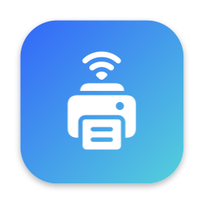
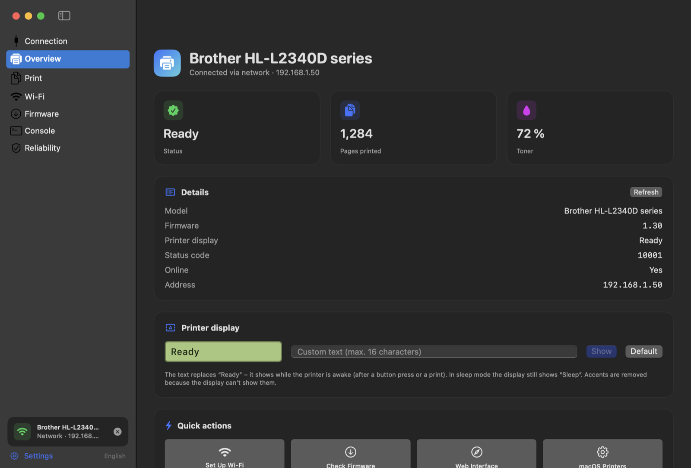
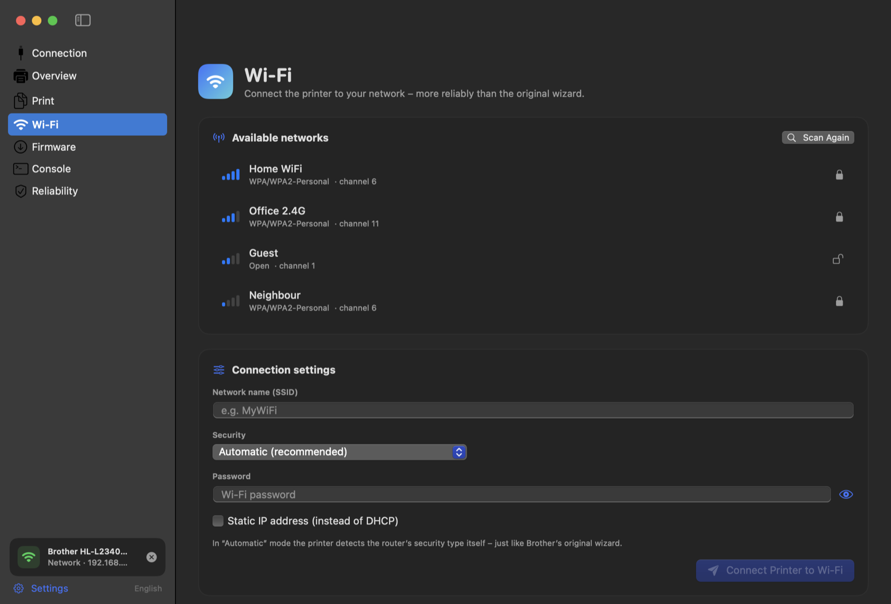
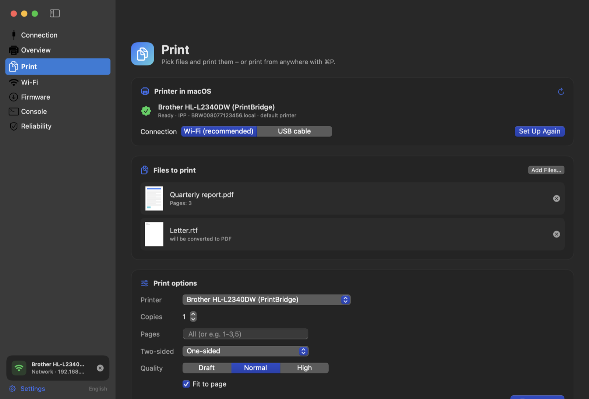
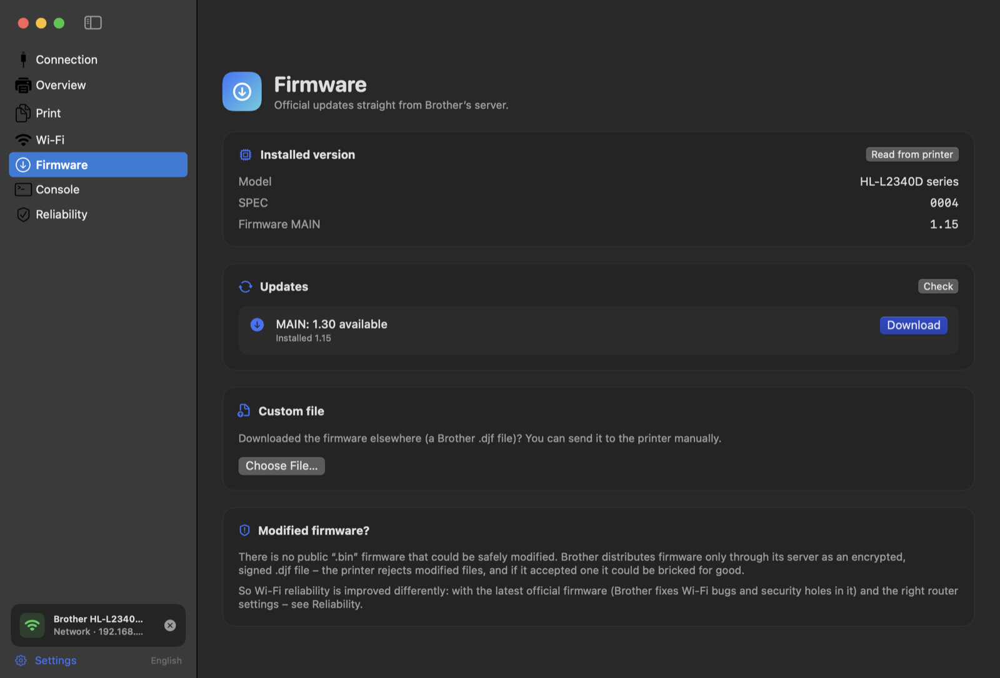
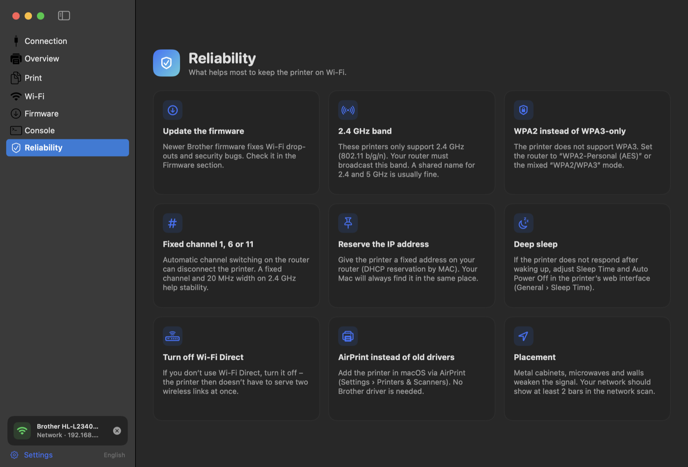

<div align="center">



# PrintBridge

**A modern macOS companion for Brother laser printers.**<br>
Set up Wi‑Fi over USB, update firmware, print from anywhere – without Brother's legacy Intel‑only tools.

[](https://github.com/JiriSobota/PrintBridge/releases/latest)




</div>

---

## Why?

Brother's *USB Wireless Setup Wizard* for the Mac is a 32/64‑bit Intel app from another era, and the firmware updater built into older printers can no longer talk to Brother's servers. PrintBridge re‑implements what those tools do – using the **same printer protocols** – in a native, universal SwiftUI app.

It was born from a real problem: an HL‑L2340DW that kept "falling asleep" on Wi‑Fi. The fix turned out to be a firmware update (1.15 → 1.30) that no official tool on the Mac could deliver any more. PrintBridge did it over USB.

## Features

| | |
|---|---|
| 📶 **Wi‑Fi setup over USB** | Let the printer scan for networks, pick one, enter the password – done. Works even when the printer is on no network at all. Validates input up front, retries with TKIP for mixed networks and explains Brother error codes (TS‑01 … TS‑08). |
| ⬇️ **Firmware updates** | Reads the installed version, asks Brother's official update server, downloads the `.djf` package and flashes it over USB or the network – with safety checks and a guided confirmation. |
| 🖨️ **Print from anywhere** | Creates a *reliable* macOS print queue (stable printer address, jobs are retried while the printer sleeps instead of failing with "The printer is not responding"). Then use ⌘P in any app, the **Print** section, Finder *Services*, *Open With*, the Dock icon or **Share**. Word/RTF/ODT/HTML are converted to PDF automatically. |
| 💬 **Custom display text** | Replace "Ready" on the printer's LCD with your own message. |
| 📊 **Status at a glance** | Model, firmware, page count, toner level, live status. |
| 🧑‍💻 **PJL console** | Talk to the printer directly – with presets and an exportable log. |
| 🛡️ **Reliability guide** | The router and printer settings that actually keep a printer online. |
| 🌍 **8 languages** | English, Čeština, Deutsch, Français, Polski, Русский, 日本語, 简体中文 – follows the system language (falls back to English) and can be switched in **Settings** (⌘,). |

<div align="center">
 
 
</div>

## Download & install

1. Download **`PrintBridge-x.y.z.zip`** from the [latest release](https://github.com/JiriSobota/PrintBridge/releases/latest) and unzip it.
2. Move **PrintBridge.app** to **Applications**.
3. The app is open source and ad‑hoc signed (not notarized), so the first launch needs one extra step:
   right‑click the app → **Open** → **Open**. Or in Terminal:
   ```bash
   xattr -dr com.apple.quarantine /Applications/PrintBridge.app
   ```

Requires macOS 14 Sonoma or later, Apple Silicon or Intel.

## Compatibility

PrintBridge speaks Brother's PJL dialect (including the `OBJBRNET` network objects used by Brother's own setup wizard), SNMP, IPP and Brother's firmware update API.

| Level | Printers |
|---|---|
| ✅ **Tested end‑to‑end** | **HL‑L2340DW** – status, display text, Wi‑Fi read‑out, firmware 1.15 → 1.30 over USB, printing |
| 🟢 **Wi‑Fi setup over USB** *(same protocol as Brother's wizard for these models)* | DCP‑7189DW, DCP‑L2520DW, DCP‑L2540DW, DCP‑L2560DW, HL‑2569DW, HL‑L2305W, HL‑L2315DW, HL‑L2340DW, HL‑L2360DW, HL‑L2380DW, MFC‑7889DW, MFC‑L2685DW, MFC‑L2700DW, MFC‑L2720DW, MFC‑L2740DW |
| 🟡 **Status, display text, console** *(USB‑only siblings from the same driver family)* | DCP‑7080/7080D/7180DN, DCP‑L2500D/L2520D/L2540DN/L2560DN, FAX‑L2700DN, HL‑2260/2260D/2560DN, HL‑L2300D/L2320D, MFC‑7380/7480D/7880DN, MFC‑L2700/L2720DN/L2760DN – very likely also other Brother lasers that speak PJL (not verified) |
| 🔵 **Firmware check & update** | Brother printers and MFCs served by Brother's update server (community‑verified on many laser models – see credits) |
| ⚪ **Print section** | Any printer macOS can print to |

> The model list comes from the model table inside Brother's official *USB Wireless Setup Wizard* (driver family `Sprn091`). Reports for other models are very welcome – please [open an issue](https://github.com/JiriSobota/PrintBridge/issues) with your model and firmware version.

## How it works

<details>
<summary><b>Wi‑Fi over USB (PJL <code>OBJBRNET</code>)</b></summary>

Brother's wizard sends PJL jobs over the USB printer class interface. PrintBridge reproduces them byte for byte, for example:

```text
ESC%-12345X@PJL
@PJL DEFAULT OBJBRNET="458867:0"          reset setup status
@PJL DEFAULT OBJBRNET="459138.2:1"        enable wireless
@PJL DEFAULT OBJBRNET="458877:48-6f-6d-65" SSID (UTF‑8 → hex)
@PJL DEFAULT OBJBRNET="459288:…"          passphrase (simple mode)
@PJL DEFAULT OBJBRNET="458865:5"          apply – printer detects the security type
ESC%-12345X
```

…then polls `458867` until the printer reports success and reads the error code (`459619`) if it fails. Network scans use `458845` and `@PJL INFO AVAILABLEWLAN`. All object IDs are documented in [`BrotherNet.swift`](Sources/BrotherKit/BrotherNet.swift).
</details>

<details>
<summary><b>Firmware updates</b></summary>

Version and `SPEC` come from SNMP (`1.3.6.1.4.1.2435.2.4.3.99.3.1.6.1.2`) or PJL. Brother's update endpoint answers `VERSIONCHECK 2` unless the request uses `INSPECTMODE 0` and `DRIVER EWS` – with that, it returns the download URL of the official `.djf` package (a PJL `EXECUTE BRDOWNLOAD` job), which is streamed to the printer. Only the model, SPEC and version are sent; downloads are restricted to Brother domains.
</details>

<details>
<summary><b>Why printers "fall asleep" on a Mac</b></summary>

- The default macOS queue (`dnssd://…`) looks the printer up via Bonjour **for every job**; a sleeping printer answers too late and the job fails with *"The printer is not responding"*. PrintBridge's queue uses the printer's stable `BRW…local` name and `printer-error-policy=retry-job`.
- Older firmware (e.g. HL‑L2340DW 1.15) buffers PJL data in deep sleep and only processes it when woken by something else. Firmware 1.30 answers instantly.
</details>

## Build from source

Only the Xcode **Command Line Tools** are needed.

```bash
git clone https://github.com/JiriSobota/PrintBridge.git
cd PrintBridge
./build.sh          # → build/PrintBridge.app (universal)
./build.sh --zip    # + build/PrintBridge-<version>.zip
```

| Path | |
|---|---|
| `Sources/BrotherKit` | Protocol layer – USB (IOUSBHost), TCP 9100, PJL, OBJBRNET, SNMP, firmware API, CUPS |
| `Sources/PrintBridge` | SwiftUI app |
| `Sources/pbctl` | Command‑line tool: `pbctl list`, `pbctl pjl "@PJL INFO ID"`, `pbctl queues`, `pbctl discover`, `pbctl send <file>` |
| `Sources/BrotherKitSelfTest` | Protocol self‑tests (run by `build.sh`) |
| `ShareExtension` | The *Share › PrintBridge* extension |
| `Resources/Localization` | Translations – `python3 scripts/check_strings.py` validates them |

Screenshots in this README are generated from a demo mode with fictional data:

```bash
PB_DEMO=1 PB_LANG=en PB_SNAPSHOT=docs/screenshots build/PrintBridge.app/Contents/MacOS/PrintBridge
```

## Translations

Keys are the English texts (`Resources/Localization/keys.json`). To add a language, create `<code>.lproj/Localizable.strings`, add the code to `L10n.languages` and `CFBundleLocalizations`, and run `python3 scripts/check_strings.py <code>`.

## Privacy

PrintBridge talks only to your printer and – when you check for firmware – to Brother's update server (model, SPEC and firmware version only, no serial number). No analytics, no accounts.

## Disclaimer

PrintBridge is an independent open‑source project and is **not affiliated with, endorsed by or supported by Brother Industries, Ltd.** "Brother" and model names are trademarks of their respective owners. Flashing firmware always carries some risk – keep the printer powered and connected until it restarts on its own.

## Credits

Firmware‑API insights from [oh-brother](https://github.com/CauldronDevelopmentLLC/oh-brother) and [brother_printer_fwupd](https://github.com/sedrubal/brother_printer_fwupd). Wi‑Fi protocol reconstructed from Brother's own Mac setup wizard.

## License

[MIT](LICENSE) © 2026 Jiří Sobota
